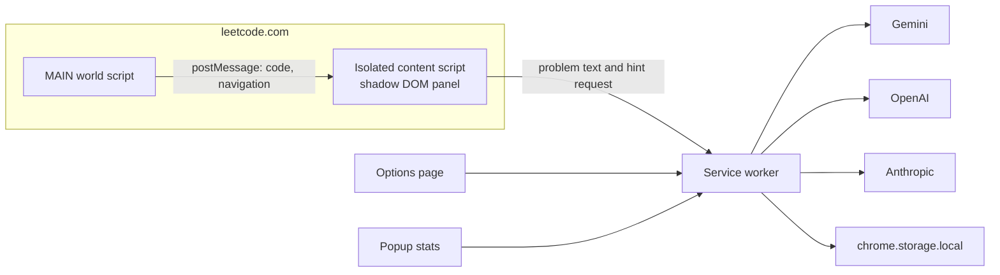

# HintLadder

HintLadder is a Chrome extension (Manifest V3) that gives progressive hints on [leetcode.com](https://leetcode.com) practice problems. Each rung is generated only when you ask for it, conditioned on the rungs you have already seen, so you keep as much of the thinking as possible.

It is a learning aid. It does not run on contest pages, and it does not phone home: you bring your own model API key, and that key stays in the extension service worker.

## Ladder

1. **Category** — which family of technique fits, and why the problem's shape suggests it. No algorithm.
2. **Key insight** — the observation that unlocks the problem, usually as a question.
3. **Approach** — plain-English steps, plus target time and space. No code.
4. **Pseudocode** — language-agnostic pseudocode, not a runnable program.
5. **Full solution** — off by default. Turn it on in options. Confirming it still waits (10 minutes by default) after the first hint on that problem.

**Review my attempt** reads the editor and nudges you toward the weak spot. It does not hand back corrected code.

Hints are blurred until you click them. A think-first cooldown (default 30 seconds) sits between rungs. "I solved it" records the highest rung you used, the time since the first hint, and the topic tags. An Accepted result on the page asks before it records the same thing.

## Setup

Requirements: Node.js 20 or newer, and a Gemini, OpenAI, or Anthropic API key.

```bash
npm install
npm test
npm run build
```

The unpacked extension is the `dist` folder.

1. Open `chrome://extensions`.
2. Turn on Developer mode.
3. Choose "Load unpacked" and select `dist`.
4. Open the HintLadder options page and save a provider, model, and API key. Use "Test key" to check it.
5. Open a practice problem such as `https://leetcode.com/problems/two-sum/`. Use the ladder button or Alt+H.

If Alt+H does nothing, set the "Toggle the HintLadder panel" command at `chrome://extensions/shortcuts`. Chrome only applies the suggested shortcut when it is free.

`npm run dev` starts the CRXJS dev server for extension reload during development. Load the dev build the same way if you use it; production installs should use `dist` from `npm run build`.

## Architecture

The LeetCode page never sees the API key. The isolated content script collects the problem and renders the panel inside a shadow root. A MAIN-world script reads Monaco and reports client-side navigations. The service worker calls the model.



Problem text comes from a same-origin `question(titleSlug:)` GraphQL query. If that fails, the content script scrapes the description. HTML is turned into text with `DOMParser`, and `<sup>` becomes `^`. Premium problems with null content get a short explanation instead of a hint.

Editor text comes from `window.monaco.editor.getModels()`. The bridge checks `event.source` and a per-request nonce. If Monaco is not ready, it falls back to `.view-lines`.

Model output must be JSON (`level`, `title`, `body`, `conceptsToReview`). Zod checks it. A spoiler guard rejects code fences and code-like lines on the early rungs, retries once with a stricter instruction, then shows an error. Markdown is rendered with `marked` and sanitized with DOMPurify.

Hints are cached per problem slug, rung, provider, model, and hint style. Regenerate replaces that entry. Switching problems aborts the in-flight request.

## Permissions

- `storage` — settings, hint cache, and history on this browser.
- Host access to `leetcode.com` and the three model API hosts.

leetcode.cn is out of scope: the extension does not run there. Contest URLs show a disabled state and do not request hints.

## Development

```bash
npm test
npm run lint
npm run build
```

Unit tests cover GraphQL parsing, HTML-to-text, the prompt builder, the spoiler guard, cache keys, rung gating and cooldown, the Zod schema, and stats aggregation. Fixtures live in `fixtures/`.
